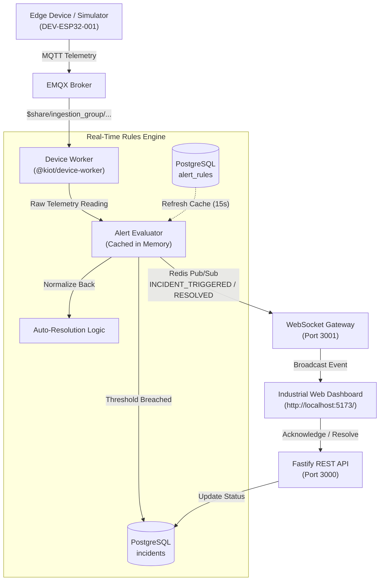

# KIOT Platform – Automated Alerting & Incident Management Engine

The **KIOT Alerting & Incident Management Engine** provides automated threshold violation detection, incident lifecycle tracking, operator acknowledgment workflows, and real-time audio-visual notifications across the platform.

---

## 1. Architectural Overview

---

## 2. Database Schema & RLS Security

The alerting system uses two core relational tables protected by PostgreSQL Row-Level Security (RLS) under migration `20261104000004_alert_rules_and_incidents.sql`:

### 2.1 `alert_rules` Table
Defines condition boundaries and severity criteria for a given metric.
- `id` (UUID, Primary Key)
- `organization_id` (UUID, Tenant Foreign Key)
- `product_id` (`home`, `cold`, `industrial`, `energy`)
- `device_id` (Nullable string: when `NULL`, applies universally to all devices reporting this metric)
- `name` (Human-readable rule name, e.g. *High Radial Spindle Vibration*)
- `metric` (Target metric key, e.g. `vibration_rms`, `temperature_bearing`, `power_kw`)
- `condition` (`GT`, `GTE`, `LT`, `LTE`, `EQ`, `NEQ`)
- `threshold` (Float boundary value)
- `severity` (`INFO`, `WARNING`, `CRITICAL`)
- `is_enabled` (Boolean active flag)

### 2.2 `incidents` Table
Captures discrete incident occurrences with state progression:
$$\text{OPEN} \longrightarrow \text{ACKNOWLEDGED} \longrightarrow \text{RESOLVED}$$
- `id` (UUID, Primary Key)
- `organization_id` (UUID, Tenant Foreign Key)
- `rule_id` (UUID, References `alert_rules(id)`)
- `device_id` (Target device ID)
- `metric` (Breached metric)
- `trigger_value` (Exact value captured at the moment of breach)
- `threshold_value` (Threshold configured at breach time)
- `severity` (`INFO`, `WARNING`, `CRITICAL`)
- `status` (`OPEN`, `ACKNOWLEDGED`, `RESOLVED`)
- `acknowledged_by` (UUID of user who acknowledged the alarm)
- `acknowledged_at` (Timestamp of acknowledgment)
- `resolved_by` (UUID of user who resolved the incident, or `NULL` if auto-resolved)
- `resolved_at` (Timestamp of resolution)

---

## 3. Real-Time In-Memory Rules Evaluator

The `AlertEvaluator` (`services/device-worker/src/alerts/evaluator.ts`) delivers sub-millisecond evaluation directly inside the IoT ingestion pipeline:
1. **Rule Caching:** Active rules are kept in memory and refreshed every 15 seconds to avoid DB query bottlenecks on high-throughput MQTT streams.
2. **De-duplication / Throttle:** Maintains an `activeIncidents` map (`${ruleId}:${deviceId}`). When a machine remains in an abnormal state, it avoids flooding the database with duplicate incidents on every incoming 1-second packet.
3. **Auto-Resolution:** When sensor readings return back below the safety threshold (e.g., after an operator clears an emergency stop or faults reset in the simulator), the engine transitions the incident to `RESOLVED` and pushes `INCIDENT_RESOLVED` to all active WebSocket clients.

---

## 4. REST API Endpoints

All endpoints require multi-tenant authentication (`X-KIOT-Organization-Id`):

| Method | Endpoint | Description |
| :--- | :--- | :--- |
| `GET` | `/v1/alert-rules` | List configured rules for the active organization |
| `POST` | `/v1/alert-rules` | Create a new alert rule |
| `DELETE` | `/v1/alert-rules/:id` | Delete an existing alert rule |
| `GET` | `/v1/incidents` | Query incident history with filters (`status`, `severity`, `deviceId`) |
| `POST` | `/v1/incidents/:id/acknowledge` | Acknowledge an active alarm with user signature |
| `POST` | `/v1/incidents/:id/resolve` | Mark an incident as resolved |

---

## 5. Web UI Features (`apps/industrial`)

1. **Global High-Visibility Alarm Banner (`AlertBanner.tsx`):**
   - Displays pulsing red/amber alerts at the top of the interface whenever a `CRITICAL` or `WARNING` incident triggers.
   - Includes one-click **"Acknowledge"** button and quick navigation to incident details.
2. **Sidebar Live Alarm Badge (`Sidebar.tsx`):**
   - Displays an animated counter badge on the **Alerts & Incidents** navigation tab showing the count of open alarms.
3. **Dedicated Incident Operations View (`AlertsView.tsx`):**
   - Severity KPI cards (Critical, Open, Acknowledged, Active Rules).
   - Filterable stream table (`ALL`, `OPEN`, `ACKNOWLEDGED`, `RESOLVED`).
   - One-click **Acknowledge** and **Resolve** action buttons.
   - Configured rules overview card.

---

## 6. Testing with the Device Simulator

1. Open the [Industrial Operations Dashboard](http://localhost:5173/).
2. In the simulator terminal:
   - Press **`[3]`** to inject a Vibration Fault ($\text{Vibration} > 5.2\text{ mm/s}$).
   - Notice the red alarm banner immediately appear at the top of the browser window.
   - Navigate to the **Alerts & Incidents** tab to see the incident details.
   - Click **"Acknowledge"** $\rightarrow$ Status changes to `ACKNOWLEDGED`.
   - Press **`[6]`** in the simulator terminal to reset faults $\rightarrow$ Vibration drops to $\sim 1.2\text{ mm/s}$, and the incident transitions to `RESOLVED`.

