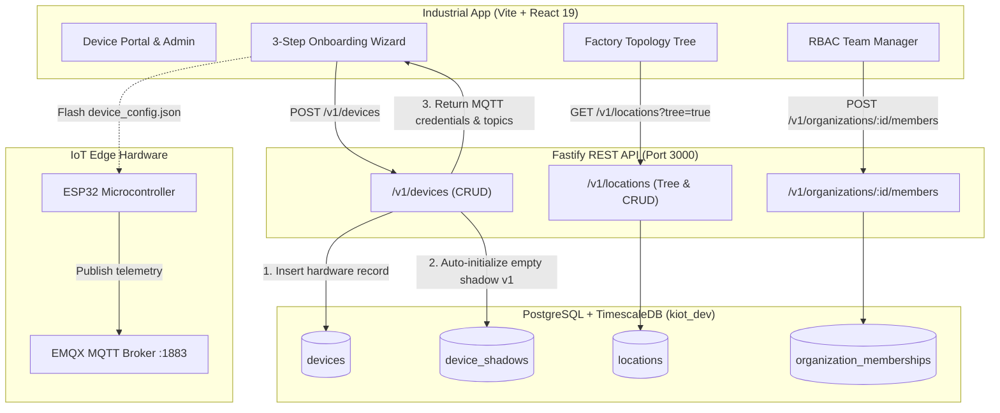

# Device Onboarding Wizard & Management Portal (Phase 7C)

The **KIOT Device Onboarding & Management Portal** provides end-to-end administration for multi-tenant IoT hardware fleets, hierarchical manufacturing plants, and team access control.

---

## 1. System Architecture



---

## 2. Backend REST Endpoints

### 2.1 Device Management (`/v1/devices`)

| Method | Endpoint | Description | RLS Roles |
|---|---|---|---|
| `GET` | `/v1/devices` | List fleet devices with optional filters (`product`, `gateway_id`, `status`) | All Org Members |
| `GET` | `/v1/devices/:id` | Fetch device details and current Device Shadow | All Org Members |
| `POST` | `/v1/devices` | Onboard hardware, initialize Device Shadow, generate MQTT topics | `owner`, `admin`, `manager` |
| `PUT` | `/v1/devices/:id` | Update device name, location, gateway, firmware, metadata | `owner`, `admin`, `manager` |
| `DELETE` | `/v1/devices/:id` | Decommission device and cascade-delete its shadow | `owner`, `admin`, `manager` |

#### Device Onboarding Request (`POST /v1/devices`):
```json
{
  "id": "DEV-ESP32-002",
  "name": "CNC-02 Hydraulic Sensor Node",
  "productId": "industrial",
  "hardwareType": "esp32",
  "hardwareSerial": "ESP32-SN-772211",
  "locationId": "00000000-0000-4000-e000-000000000003",
  "firmwareVersion": "1.2.0",
  "metadata": {
    "sensors": ["pressure", "flow", "oil_temp"],
    "samplingRateMs": 1000
  }
}
```

#### Onboarding Response (201 Created):
```json
{
  "device": {
    "id": "DEV-ESP32-002",
    "organization_id": "00000000-0000-4000-a000-000000000001",
    "product_id": "industrial",
    "name": "CNC-02 Hydraulic Sensor Node",
    "hardware_type": "esp32",
    "hardware_serial": "ESP32-SN-772211",
    "firmware_version": "1.2.0",
    "status": "offline",
    "created_at": "2026-11-04T07:31:28.384Z"
  },
  "provisioning": {
    "mqtt": {
      "brokerUrl": "mqtt://localhost:1883",
      "clientId": "kiot-DEV-ESP32-002",
      "telemetryTopic": "kiot/00000000-0000-4000-a000-000000000001/devices/DEV-ESP32-002/telemetry",
      "commandsTopic": "kiot/00000000-0000-4000-a000-000000000001/devices/DEV-ESP32-002/commands",
      "shadowGetTopic": "kiot/00000000-0000-4000-a000-000000000001/devices/DEV-ESP32-002/shadow/get",
      "shadowUpdateTopic": "kiot/00000000-0000-4000-a000-000000000001/devices/DEV-ESP32-002/shadow/update"
    }
  }
}
```

---

### 2.2 Factory Topology (`/v1/locations`)

Hierarchical organizational structure:
- **`site`**: Campus / Manufacturing Plant (e.g. *Pune Factory Unit 1*)
- **`building`**: Shed / Machine Shop (e.g. *Main CNC Machine Shop*)
- **`floor`**: Facility Floor Level
- **`line`**: Production / Assembly Line (e.g. *Production Line 1*)
- **`room`**: Specific Workcell or Quality Lab

| Method | Endpoint | Description |
|---|---|---|
| `GET` | `/v1/locations?tree=true` | Returns nested tree hierarchy with child nodes |
| `GET` | `/v1/locations/:id` | Returns location details, direct children, and device/machine counts |
| `POST` | `/v1/locations` | Creates a location node linked via `parentId` |
| `PUT` | `/v1/locations/:id` | Updates location name, code, type, or parent |
| `DELETE` | `/v1/locations/:id` | Deletes location (children cascade, assigned devices unlinked) |

---

### 2.3 Team & RBAC Memberships (`/v1/organizations/:id/members`)

| Role | Permissions |
|---|---|
| **`owner`** | Complete organization control, billing, add/remove admins, delete org |
| **`admin`** | Manage devices, alert rules, locations, invite team members |
| **`manager`** | Onboard devices, create locations, configure alert thresholds |
| **`operator`** | Trigger actuator commands, acknowledge incidents, monitor telemetry |
| **`viewer`** | Read-only analytics, charts, and device health status |

---

## 3. UI Features (`apps/industrial`)

Access via the left navigation bar under **"Device Portal & Admin"** (`http://localhost:5173/`):

1. **3-Step Device Onboarding Wizard:**
   - **Step 1: Hardware Identity**: Select Product Line, Hardware Type (ESP32, Linux Gateway, Modbus), Serial Number, and Firmware Version.
   - **Step 2: Factory Topology**: Assign to a Site, Building, or Production Line, and optionally assign an on-premise Gateway.
   - **Step 3: Provisioning & Credentials**: Live display of MQTT endpoints, topics, and one-click JSON copy for flashing microcontroller firmware.
2. **Device Fleet & Provisioning Tab:**
   - Searchable device inventory with real-time connectivity pills.
   - View MQTT provisioning credentials modal for any existing device.
   - Safe decommission action with confirmation prompt.
3. **Factory Locations Tree Tab:**
   - Interactive tree rendering of hierarchical plant topology.
   - Quick "Add Child" and "Add Root Site" buttons.
4. **Team & Access Control Tab:**
   - Team directory with RBAC role pills.
   - Modal to invite members with predefined roles (`admin`, `manager`, `operator`, `viewer`).

---

## 4. Verification & Testing

### Test 1: Onboard a New Virtual Device
```bash
curl -s -X POST \
  -H "Content-Type: application/json" \
  -H "X-KIOT-Organization-Id: 00000000-0000-4000-a000-000000000001" \
  -d '{
    "id": "DEV-ESP32-002",
    "name": "CNC-02 Hydraulic Sensor Node",
    "productId": "industrial",
    "hardwareType": "esp32",
    "hardwareSerial": "ESP32-SN-772211",
    "locationId": "00000000-0000-4000-e000-000000000003",
    "firmwareVersion": "1.2.0"
  }' \
  "http://localhost:3000/v1/devices" | jq .
```

### Test 2: Verify Hierarchy Tree
```bash
curl -s -H "X-KIOT-Organization-Id: 00000000-0000-4000-a000-000000000001" \
  "http://localhost:3000/v1/locations?tree=true" | jq .
```

### Test 3: Inspect in Adminer DB UI
Open your browser to:
```
http://localhost:8085/?pgsql=postgres&username=postgres&db=kiot_dev
```
- Inspect table `devices` $\rightarrow$ verify newly registered device.
- Inspect table `device_shadows` $\rightarrow$ verify initial shadow record (`desired: {}`, `reported: {}`, `version: 1`).

