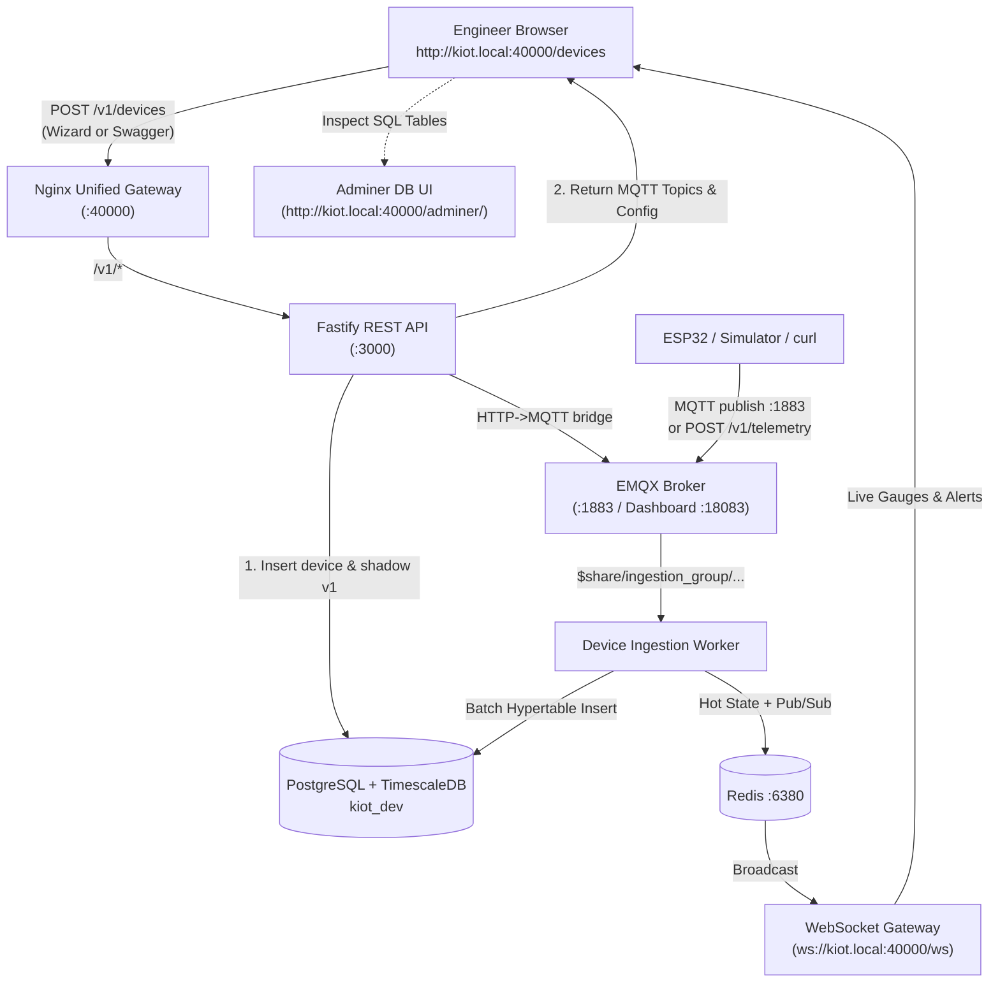

# Complete Device Onboarding & Multi-Portal Testing Guide

This guide is the single-source reference for **onboarding new IoT devices**, **choosing the right portal or API endpoint**, **streaming live telemetry**, **testing actuator controls**, and **verifying every stage** across the KIOT platform stack via the unified gateway (**`http://kiot.local:40000`**).

---

## 1. Unified Service & Portal Matrix

All web UIs, REST APIs, API documentation, WebSocket telemetry streams, and database tools are consolidated behind the Nginx reverse proxy on port **`40000`** (with EMQX running on its dedicated management and MQTT ports):

| Service | Unified Gateway URL | Target Microservice | When to Use During Onboarding & Testing |
| :--- | :--- | :--- | :--- |
| **Industrial Portal** | **`http://kiot.local:40000/`** | `host.docker.internal:5175` (React 19 + Vite HMR)\* | Daily operator UI, onboarding wizard (`/devices`), live charts, machine actuator controls, and incident monitoring |
| **Fastify REST API** | **`http://kiot.local:40000/v1/`** | `host.docker.internal:3000` (Zero CORS issues!) | Programmatic device registration (`POST /v1/devices`), HTTP telemetry ingestion (`POST /v1/telemetry`), and command dispatch |
| **Swagger API Docs** | **`http://kiot.local:40000/docs`** | `host.docker.internal:3000/docs` | Interactive OpenAPI testing in browser without `curl` |
| **Telemetry WebSocket** | **`ws://kiot.local:40000/ws`** | `host.docker.internal:3001` | Real-time UI streaming for live gauges, scope traces, and alerts |
| **Adminer (Database UI)** | **`http://kiot.local:40000/adminer/`** | `http://adminer:8080/` | Inspecting PostgreSQL rows (`devices`, `device_shadows`, `telemetry_readings`, `device_commands`) |
| **EMQX Dashboard** | **`http://kiot.local:18083`** | Dedicated port (or visit `/emqx` for redirect) | Checking live MQTT client connections, broker subscriptions, and sniffing raw packets (`Diagnose` $\rightarrow$ `WebSocket Client`) |
| **EMQX MQTT Broker** | **`localhost:1883` (TCP)** | Direct MQTT for devices and simulator | Connecting ESP32 firmware, Linux gateways, and `@kiot/device-simulator` |

> [!NOTE]
> \* **Why `5175` instead of `5173`:** The Vite frontend server in [`apps/industrial/vite.config.ts`](file:///home/ketan/projects/Krisha/kiot-platform/apps/industrial/vite.config.ts) is bound to host port `5175` and proxied to root `/` on port `40000` inside [`infrastructure/docker/nginx.conf`](file:///home/ketan/projects/Krisha/kiot-platform/infrastructure/docker/nginx.conf) to avoid conflicts with other local containers on `5173`. Always use **`http://kiot.local:40000/`** in your browser.

### Required Organization Tenant Header
Every REST API call (in `curl` or Swagger UI) runs inside strict PostgreSQL Row-Level Security (RLS) multi-tenancy and requires the organization header:

```text
X-KIOT-Organization-Id: 00000000-0000-4000-a000-000000000001
```
*(Demo tenant: **Apex Precision Manufacturing Ltd.**)*

---

## 2. End-to-End Onboarding & Verification Architecture



---

## 3. Existing Seed Devices vs. Test Device Catalog

### A. Pre-Seeded & Simulator Devices (Already Registered)
The database seed script ([`supabase/seed/seed.sql`](file:///home/ketan/projects/Krisha/kiot-platform/supabase/seed/seed.sql)) and development test fixtures already include devices in the `devices` table:

| Device ID | Friendly Name | Domain (`productId`) | Hardware (`hardwareType`) | Notes |
| :--- | :--- | :--- | :--- | :--- |
| `DEV-ESP32-001` | CNC-01 Sensor Node | `industrial` | `esp32` | Linked to machine `CNC-01` & Gateway `GW-PUN-001` |
| `DEV-METER-001` | Main Feeder Energy Meter | `energy` | `third_party` | Seeded energy meter (`SN-MTR-994821`) |
| `DEV-ESP32-002` | CNC-02 Hydraulic Sensor Node | `industrial` | `esp32` | Registered in dev DB (`ESP32-SN-772211`) |
| `DEV-ESP32-003` | Stamping Press #3 Vibration Sensor | `industrial` | `esp32` | Simulated by `pnpm sim:device` |

> [!WARNING]
> **Avoid `409 Conflict` ("Device with ID '...' already exists"):**
> Fastify validates uniqueness on both **`id`** and **`hardwareSerial`** in [`services/api/src/routes/devices.ts`](file:///home/ketan/projects/Krisha/kiot-platform/services/api/src/routes/devices.ts). If you try to onboard `DEV-ESP32-002` while it is already in the table, the API rejects it with `409 Conflict`. Either pick a fresh ID from Table B below, or delete the existing device row first in **Device Portal & Admin**.

### B. 5 Sample Devices Ready to Onboard & Test
Use any of these fresh device profiles when testing the Onboarding Wizard or Swagger API (`productId` must be one of `industrial`, `energy`, `cold`, or `home` per [`packages/validation/src/device.schema.ts`](file:///home/ketan/projects/Krisha/kiot-platform/packages/validation/src/device.schema.ts)):

| Device ID | Friendly Name | Product Domain (`productId`) | Hardware Architecture (`hardwareType`) | Hardware Serial | Recommended Location |
| :--- | :--- | :--- | :--- | :--- | :--- |
| **`DEV-ESP32-004`** | CNC-03 Spindle & Thermal Node | `industrial` | `esp32` | `SN-ESP32-991122` | `[LINE] Production Line 1 (LINE-01)` |
| **`DEV-METER-002`** | Compressor Room Sub-Meter | `energy` | `third_party` | `SN-MTR-994822` | `[BUILDING] Main CNC Machine Shop (BLD-A)` |
| **`DEV-ENV-001`** | Assembly Cleanroom Climate Station | `cold` *(Cold Storage & HVAC)* | `esp32` | `SN-ENV-100234` | `[SITE] Pune Factory Unit 1 (PUN-01)` |
| **`DEV-PRESS-001`** | Stamping Press Hydraulic Monitor | `industrial` | `esp32` | `SN-PRS-771920` | `[LINE] Production Line 1 (LINE-01)` |
| **`DEV-FURNACE-001`** | Tempering Furnace Pyrometer | `industrial` | `esp32` | `SN-FRN-554101` | `[LINE] Production Line 1 (LINE-01)` |

---

## 4. Method 1: Step-by-Step Onboarding via Industrial Portal UI

**Target Portal:** `http://kiot.local:40000/devices` (served via Vite HMR behind Nginx `:40000`)

### Step 1: Open the Device Portal & Inspect Existing Fleet
1. Open **[http://kiot.local:40000/devices](http://kiot.local:40000/devices)** directly in your browser — or open **[http://kiot.local:40000/](http://kiot.local:40000/)** and click **`Device Portal & Admin`** (7th item under *Manufacturing Floor* in the left sidebar).
2. On the **`Device Fleet & Provisioning`** tab:
   - Use the **Search box** (`Search device ID, name, serial...`) or **Product Domain dropdown** to check whether an ID like `DEV-ESP32-002` already exists.
   - Click **`Credentials`** (🔑 icon) on any existing row to inspect its MQTT topics and copy `device_config.json`.
   - Click the **Trash icon (🗑️)** on any test row if you want to decommission it and test onboarding the same ID again from scratch.
3. Click the amber **`+ Onboard New Device`** button in the top-right corner.

### Step 2: Wizard Step 1 — Hardware Identity
Fill out the physical hardware identity form (rendered by [`DeviceOnboardingModal.tsx`](file:///home/ketan/projects/Krisha/kiot-platform/apps/industrial/src/components/Management/DeviceOnboardingModal.tsx)):

- **Device Identifier (ID)\*:** Auto-uppercased alphanumeric ID with dashes/underscores (e.g., `DEV-ESP32-004` or `DEV-METER-002`).
- **Friendly Device Name\*:** Descriptive asset label (e.g., `Compressor Room Sub-Meter`).
- **Product Domain:** Choose from:
  - `Industrial Machinery (IIoT)` (`industrial`)
  - `Energy & Power Metering` (`energy`)
  - `Cold Storage & HVAC` (`cold`)
  - `Home Automation` (`home`)
- **Hardware Architecture:** Choose from:
  - `ESP32 Microcontroller (Dual-Core FreeRTOS)` (`esp32`)
  - `Linux Edge Gateway / IPC` (`linux_gateway`)
  - `Third-Party Modbus / RS485` (`third_party`)
- **Hardware Serial Number\*:** Must be unique across the fleet (e.g., `SN-MTR-994822`).
- **Initial Firmware Version:** Defaults to `1.0.0` (or enter e.g. `1.2.0`).

Click **`Continue to Topology`** $\rightarrow$.

### Step 3: Wizard Step 2 — Factory Topology
Associate the device with physical plant infrastructure:

- **Factory Location (Plant / Line / Workcell):** Select one of the seeded locations (`[SITE] Pune Factory Unit 1 (PUN-01)`, `[BUILDING] Main CNC Machine Shop (BLD-A)`, `[LINE] Production Line 1 (LINE-01)`), or create new nodes in the **`Factory Locations & Hierarchy`** tab.
- **Assigned Industrial Edge Gateway (Optional):** Choose `Moxa UC-8100 Gateway (Moxa Linux Edge Gateway) - 192.168.1.100` (`GW-PUN-001`) or leave as `-- Direct Cloud / Wi-Fi Connection (No Gateway) --`.
- **Telemetry Sampling Rate (ms):** Polling loop period in milliseconds (`100` to `60000`, default `1000` = 1Hz).

Click **`Complete Onboarding & Generate Credentials`**.

### Step 4: Wizard Step 3 — Provisioning & Credentials
Once `POST /v1/devices` returns `201 Created`, the database has inserted the `devices` record and initialized an empty `device_shadows` row (`version: 1`). Copy the generated provisioning parameters:

- **MQTT Broker URL:** `mqtt://localhost:1883` *(physical hardware on LAN uses your workstation LAN IP instead of `localhost`)*
- **Telemetry Topic (Publish):**
  `kiot/00000000-0000-4000-a000-000000000001/devices/<DEVICE_ID>/telemetry`
- **Commands Topic (Subscribe):**
  `kiot/00000000-0000-4000-a000-000000000001/devices/<DEVICE_ID>/commands`
- **Device Shadow Get / Update:**
  `kiot/00000000-0000-4000-a000-000000000001/devices/<DEVICE_ID>/shadow/update`
- **Flash Config (`device_config.json`):** Click **`Copy JSON`** to copy the entire provisioning object (which also includes `"clientId": "kiot-<DEVICE_ID>"`).

Click **`Close & View in Fleet`** to confirm the device now appears in the table.

---

## 5. Method 2: Onboarding via Swagger UI or REST API

Use this method when automating bench provisioning or testing validation errors directly.

### Option A: Interactive Swagger Docs (`http://kiot.local:40000/docs`)
1. Open **[http://kiot.local:40000/docs](http://kiot.local:40000/docs)**.
2. Expand the **`Devices`** section $\rightarrow$ **`POST /v1/devices`** $\rightarrow$ click **`Try it out`**.
3. Set header `X-KIOT-Organization-Id` to `00000000-0000-4000-a000-000000000001`.
4. Paste a JSON body (example below) and click **`Execute`**.

### Option B: CLI `curl` Command (`http://kiot.local:40000/v1/devices`)
Example registering **`DEV-METER-002`**:

```bash
curl -s -X POST "http://kiot.local:40000/v1/devices" \
  -H "Content-Type: application/json" \
  -H "X-KIOT-Organization-Id: 00000000-0000-4000-a000-000000000001" \
  -d '{
    "id": "DEV-METER-002",
    "name": "Compressor Room Sub-Meter",
    "productId": "energy",
    "hardwareType": "third_party",
    "hardwareSerial": "SN-MTR-994822",
    "locationId": "00000000-0000-4000-e000-000000000002",
    "gatewayId": "GW-PUN-001",
    "firmwareVersion": "1.0.0",
    "metadata": {
      "samplingRateMs": 1000,
      "registeredVia": "REST_CLI"
    }
  }'
```

Expected status is **`201 Created`** containing both `device` and `provisioning.mqtt`.
- If `id` or `hardwareSerial` already exists: returns **`409 Conflict`**.
- If `locationId` does not belong to the organization: returns **`400 Bad Request`**.

---

## 6. Testing Telemetry Ingestion, Alerts & Actuator Controls

### A. Zero-Trust Tenant Enforcement (Why Un-onboarded Devices Return 404)
The HTTP ingestion route (`POST /v1/telemetry` in [`services/api/src/routes/telemetry.ts`](file:///home/ketan/projects/Krisha/kiot-platform/services/api/src/routes/telemetry.ts)) verifies that `device_id` exists in the active `organization_id` **before** publishing to EMQX:

- **Device not onboarded yet:** Returns `404 Not Found` (`"Device 'DEV-METER-002' not found in this organization."`).
- **Device onboarded:** Dispatches the payload to EMQX (`kiot/<orgId>/devices/<deviceId>/telemetry`) and returns:
  ```json
  {
    "success": true,
    "message": "Telemetry ingested and dispatched to real-time ingestion pipeline",
    "deviceId": "DEV-METER-002"
  }
  ```

### B. HTTP Telemetry Test Commands (`POST http://kiot.local:40000/v1/telemetry`)
Once you onboard each device from Section 3B, test its pipeline immediately:

```bash
# 1. CNC Spindle & Vibration Node (DEV-ESP32-004)
curl -s -X POST "http://kiot.local:40000/v1/telemetry" \
  -H "Content-Type: application/json" \
  -H "X-KIOT-Organization-Id: 00000000-0000-4000-a000-000000000001" \
  -d '{"device_id":"DEV-ESP32-004","metrics":{"spindle_speed":3100,"temperature":58.4,"vibration":2.1,"coolant_flow":11.8}}'

# 2. Compressor Room Sub-Meter (DEV-METER-002)
curl -s -X POST "http://kiot.local:40000/v1/telemetry" \
  -H "Content-Type: application/json" \
  -H "X-KIOT-Organization-Id: 00000000-0000-4000-a000-000000000001" \
  -d '{"device_id":"DEV-METER-002","metrics":{"voltage_l1":415.2,"current_l1":38.4,"active_power":24.6,"power_factor":0.94,"energy_total":18420.5}}'

# 3. Assembly Cleanroom Climate Station (DEV-ENV-001)
curl -s -X POST "http://kiot.local:40000/v1/telemetry" \
  -H "Content-Type: application/json" \
  -H "X-KIOT-Organization-Id: 00000000-0000-4000-a000-000000000001" \
  -d '{"device_id":"DEV-ENV-001","metrics":{"ambient_temp":22.4,"humidity":45.1,"air_quality_index":28,"atmospheric_pressure":1013.2}}'

# 4. Stamping Press Hydraulic Monitor (DEV-PRESS-001)
curl -s -X POST "http://kiot.local:40000/v1/telemetry" \
  -H "Content-Type: application/json" \
  -H "X-KIOT-Organization-Id: 00000000-0000-4000-a000-000000000001" \
  -d '{"device_id":"DEV-PRESS-001","metrics":{"hydraulic_pressure":185.0,"oil_temp":62.5,"oil_level":88.0}}'

# 5. Tempering Furnace High-Temp Test (DEV-FURNACE-001)
curl -s -X POST "http://kiot.local:40000/v1/telemetry" \
  -H "Content-Type: application/json" \
  -H "X-KIOT-Organization-Id: 00000000-0000-4000-a000-000000000001" \
  -d '{"device_id":"DEV-FURNACE-001","metrics":{"temperature":84.5,"door_state":0}}'
```

> [!TIP]
> **Triggering Seeded Incident Alerts (`DEV-ESP32-001` & `DEV-METER-001`):**
> Pre-seeded alert rules in [`20261104000004_alert_rules_and_incidents.sql`](file:///home/ketan/projects/Krisha/kiot-platform/supabase/migrations/20261104000004_alert_rules_and_incidents.sql) watch `vibration_rms > 4.5` or `temperature_bearing > 72.0` on `DEV-ESP32-001`, and `power_kw > 20.0` on `DEV-METER-001`. Test an instant thermal alert via:
> ```bash
> curl -s -X POST "http://kiot.local:40000/v1/telemetry" \
>   -H "Content-Type: application/json" \
>   -H "X-KIOT-Organization-Id: 00000000-0000-4000-a000-000000000001" \
>   -d '{"device_id":"DEV-ESP32-001","metrics":{"temperature_bearing":79.5,"vibration_rms":5.2}}'
> ```

### C. Query Latest Telemetry & History via API
```bash
# Latest state (checks Redis hot cache first, falls back to telemetry_readings)
curl -s -H "X-KIOT-Organization-Id: 00000000-0000-4000-a000-000000000001" \
  "http://kiot.local:40000/v1/telemetry/latest?device_id=DEV-ESP32-001"

# Historical raw points or TimescaleDB aggregates (raw | 1m | 1h)
curl -s -H "X-KIOT-Organization-Id: 00000000-0000-4000-a000-000000000001" \
  "http://kiot.local:40000/v1/telemetry/history?device_id=DEV-ESP32-001&resolution=raw&limit=20"
```

### D. Testing Bidirectional Actuator Controls
1. Open **Fleet Overview** (**`http://kiot.local:40000/`**) or **CNC & Machines** (**`http://kiot.local:40000/machines`**).
2. Scroll to **Active Factory Machine Units** and click **`Control`** on any machine row.
3. The full-screen **Command Control Modal** opens (rendered into `document.body` via React Portal) allowing you to dispatch **`SET_SPEED`**, toggle the **Coolant Pump (`SET_RELAY`)**, or trigger **`EMERGENCY_STOP`** over `POST /v1/devices/:id/commands` and EMQX QoS 1.

---

## 7. Cross-Portal Verification Checklist

After onboarding or sending test telemetry, verify the full pipeline across all 4 consoles:

| Check | Portal URL | Where to Look & Expected Result |
| :--- | :--- | :--- |
| **1. UI Fleet & Live Charts** | [`http://kiot.local:40000/devices`](http://kiot.local:40000/devices) & [`http://kiot.local:40000/`](http://kiot.local:40000/) | New device appears in **Device Fleet & Provisioning**; live telemetry updates over `ws://kiot.local:40000/ws`; **Telemetry Scope** plots incoming metrics |
| **2. Database Tables (Adminer)** | [`http://kiot.local:40000/adminer/`](http://kiot.local:40000/adminer/) *(or `:8085`)* | Log in with System **`PostgreSQL`**, Server **`postgres`**, Username **`postgres`**, Password **`postgres`**, Database **`kiot_dev`**. Inspect `devices`, `device_shadows`, `telemetry_readings`, `device_commands`, and `incidents` |
| **3. MQTT Broker (EMQX)** | [`http://kiot.local:18083`](http://kiot.local:18083) *(or `/emqx`)* | Log in with `admin` / `kiotadmin123`. Check **Management $\rightarrow$ Clients** for active devices, **Management $\rightarrow$ Subscriptions** for worker bindings (`$share/ingestion_group/kiot/+/devices/+/telemetry`), and **Diagnose $\rightarrow$ WebSocket Client** subscribed to `kiot/#` to sniff raw JSON packets live |
| **4. REST API & Docs (Swagger)** | [`http://kiot.local:40000/docs`](http://kiot.local:40000/docs) | Execute `GET /v1/devices`, `POST /v1/devices`, `GET /v1/telemetry/latest`, and `POST /v1/telemetry` directly in-browser with zero CORS errors |
