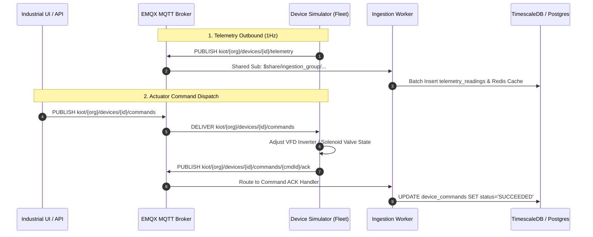

# KIOT Edge Device Simulator

The **KIOT Edge Device Simulator** (`services/device-simulator`, `@kiot/device-simulator`) provides a high-fidelity virtual edge emulation engine for local development, integration testing, and automated QA without requiring physical ESP32, STM32, or industrial PLC hardware.

---

## 1. Overview & Capabilities

The simulator spins up a virtual industrial edge fleet that connects to the EMQX MQTT broker, streams realistic multi-sensor telemetry, responds to remote actuator commands dispatched from the UI/API, and sends immediate execution acknowledgements (ACKs).

| Capability | Details |
| :--- | :--- |
| **Physics Simulation** | Continuous thermodynamic, mechanical vibration, and 3-phase electrical power models |
| **Bidirectional Commands** | Listens on MQTT command topics and publishes structured ACKs (`SUCCEEDED`/`FAILED`) |
| **Fault Injection** | Interactive terminal hotkeys to inject bearing faults, overheating, high loads, and E-Stops |
| **High Resolution** | Configurable streaming rate (default: 1 packet / sec / device) |
| **Multi-Node Fleet** | Emulates both machine sensors and smart sub-metering power devices simultaneously |

---

## 2. Emulated Edge Devices

The simulator automatically initializes two pre-configured industrial nodes belonging to the default tenant (`00000000-0000-4000-a000-000000000001`):

### Node 1: CNC Milling Machine Node (`DEV-ESP32-001`)
- **Attached Machine:** Apex 5-Axis VMC (`MCH-001`)
- **Firmware:** `v2.4.1-esp32`
- **Telemetry Metrics Streamed:**
  - `spindle_speed` (RPM, 0 – 6000 RPM)
  - `bearing_temperature` (°C, ambient to 95°C)
  - `vibration_rms` (Radial mm/s, ISO 10816 monitoring)
  - `feed_rate` (mm/min)
  - `coolant_pump` (Binary state: `1` for ON, `0` for OFF)

### Node 2: 3-Phase Smart Energy Sub-Meter (`DEV-METER-001`)
- **Attached Machine:** Apex 5-Axis VMC (`MCH-001`)
- **Firmware:** `v1.1.0-modbus-rtu`
- **Telemetry Metrics Streamed:**
  - `voltage_v` (Nominal 400V RMS line-to-line with grid fluctuation)
  - `current_a` (Current drawn proportionally to CNC spindle mechanical load)
  - `power_kw` (Real active 3-phase power: $P = \sqrt{3} \times V \times I \times \cos\phi$)
  - `frequency_hz` (Nominal 50.0 Hz $\pm 0.05$ Hz)
  - `power_factor` (Inductive load factor: 0.88 – 0.94)
  - `energy_kwh` (Cumulative integrating meter)

---

## 3. MQTT Topic Architecture

The virtual fleet communicates strictly using KIOT's multi-tenant topic conventions:



### Topic Schemas

| Purpose | MQTT Topic Pattern | Direction | QoS |
| :--- | :--- | :--- | :---: |
| **Telemetry** | `kiot/{orgId}/devices/{deviceId}/telemetry` | Simulator $\rightarrow$ Broker | 0 |
| **Device State** | `kiot/{orgId}/devices/{deviceId}/state` | Simulator $\rightarrow$ Broker | 1 |
| **Inbound Commands** | `kiot/{orgId}/devices/{deviceId}/commands` | Platform $\rightarrow$ Simulator | 1 |
| **Command ACKs** | `kiot/{orgId}/devices/{deviceId}/commands/{cmdId}/ack` | Simulator $\rightarrow$ Platform | 1 |

> [!WARNING]
> The simulator subscribes **strictly** to `kiot/{orgId}/devices/{deviceId}/commands` (exactly 5 topic segments) to avoid an infinite echo loop caused by wildcard `#` matching its own ACK topics (`.../commands/{commandId}/ack`).

---

## 4. How to Run

### From Monorepo Root
```bash
# Start device simulator directly
pnpm sim:device

# Or run with dev watch mode
pnpm dev:simulator
```

### Via Workspace Filter
```bash
pnpm --filter @kiot/device-simulator dev
```

---

## 5. Interactive Keyboard Controls (Fault Injection)

When running in an interactive terminal, the simulator accepts single-keystroke commands to inject physics conditions in real time:

| Key | Mode / Action | Simulated Behavior | Observable Impact in Dashboard |
| :---: | :--- | :--- | :--- |
| **`1`** | **NORMAL** | Spindle target: 3200 RPM, Coolant ON | Green indicators, normal temperature (~48°C), vibration ~1.2 mm/s |
| **`2`** | **HIGH_LOAD** | Spindle target: 4800 RPM, Heavy cutting | Yellow indicators, power spikes to ~18 kW, thermal climb to ~62°C |
| **`3`** | **VIBRATION FAULT** | Injects high harmonic imbalance | **RED ALARM**: Vibration spikes to > 5.5 mm/s (exceeds ISO warning line) |
| **`4`** | **OVERHEAT** | Coolant fails + high friction | **RED ALARM**: Bearing temperature climbs past 78°C trip threshold |
| **`5`** | **EMERGENCY STOP** | Immediate spindle motor cutoff | Spindle decelerates to 0 RPM instantly, power drops to idle |
| **`6`** | **RESET FAULTS** | Restores nominal parameters | Clears fault status and resumes steady-state 3200 RPM |
| **`q`** | **QUIT** | Disconnects MQTT clients and exits | Simulator gracefully shuts down |

---

## 6. Supported Remote Commands

The simulator responds to remote JSON commands dispatched via the REST API (`POST /v1/devices/:id/commands`) or the **Industrial Dashboard UI**:

### 1. `SET_SPEED`
Sets the target spindle RPM on the virtual Variable Frequency Drive (VFD).
```json
{
  "commandType": "SET_SPEED",
  "payload": {
    "rpm": 4500
  }
}
```
*Simulator Action:* Smoothly ramps physical spindle speed toward target; publishes ACK:
```json
{
  "status": "SUCCEEDED",
  "reason": "VFD Inverter set target to 4500 RPM"
}
```

### 2. `SET_RELAY`
Toggles auxiliary digital output relays (e.g., coolant pump or chip conveyor).
```json
{
  "commandType": "SET_RELAY",
  "payload": {
    "relay": "coolant_pump",
    "state": "OFF"
  }
}
```

### 3. `EMERGENCY_STOP`
Triggers hardware E-Stop shutdown.
```json
{
  "commandType": "EMERGENCY_STOP",
  "payload": {}
}
```

### 4. `RESET_FAULT`
Clears machine fault state.
```json
{
  "commandType": "RESET_FAULT",
  "payload": {}
}
```

---

## 7. Physics Models Under the Hood

### Spindle RPM Inertia
The spindle motor does not change speed instantaneously; it implements an inertia ramp with acceleration rate $\alpha$:
$$\text{RPM}_{t+1} = \text{RPM}_t + \text{clamp}(\text{Target} - \text{RPM}_t, -\alpha, +\alpha)$$

### Bearing Thermodynamics
Temperature is governed by heat generation (speed $\times$ mechanical load) minus dissipation (coolant cooling factor + ambient cooling):
$$T_{t+1} = T_t + \left(\frac{\text{RPM}}{1000} \times \text{Load} \times 0.12\right) - \left(0.18 \times \text{CoolantActive}\right) - 0.05 \times (T_t - T_{\text{ambient}})$$

### Vibration Harmonics
Vibration calculates fundamental rotational frequency harmonic vibration plus random gaussian jitter:
$$V_{\text{RMS}} = \text{BaseVibration} \times \left(\frac{\text{RPM}}{3000}\right) + \text{FaultBias} + \mathcal{N}(0, 0.15)$$

### 3-Phase Power Calculation
Real active electrical power is dynamically calculated from physical machine operation:
$$P_{\text{active}} (\text{kW}) = \sqrt{3} \times V_{\text{line}} \times I_{\text{phase}} \times \cos\phi \times 10^{-3}$$
Where $I_{\text{phase}}$ tracks spindle motor current draw and cutting resistance.

