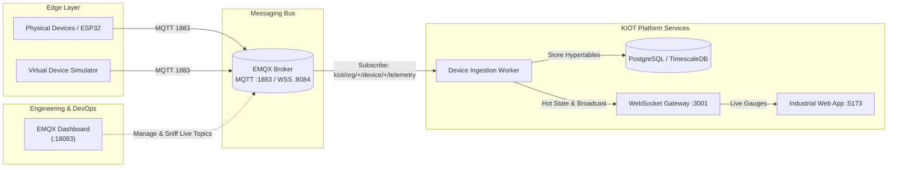

# EMQX MQTT Broker & Management Dashboard Guide

This guide explains the role of **EMQX 5.x** in the KIOT platform, how to access and utilize the **EMQX Management Dashboard**, and how to use it for debugging IoT device networking and telemetry streaming.

---

## 1. What is EMQX in KIOT?

**EMQX** (Erlang MQTT Broker) serves as the **central nervous system** of the KIOT platform. Every physical IoT device (ESP32 microcontrollers, industrial PLCs, CNC machines, energy meters) and our virtual device simulator connects to EMQX to stream real-time telemetry and receive downlink control commands.

### Architecture Overview



---

## 2. Dashboard Access & Credentials

The EMQX web management console is available in the local Docker development environment:

| Property | Value | Notes |
| :--- | :--- | :--- |
| **URL** | **[http://localhost:18083](http://localhost:18083)** | Hosted by container `kiot-emqx-dev` |
| **Username** | **`admin`** | Configured in `docker-compose.dev.yml` |
| **Password** | **`kiotadmin123`** | Default development password |
| **License / Tier** | **Open Source 5.x (Free)** | Self-hosted; no online account or credit card required |

> [!NOTE]
> The EMQX open-source dashboard may occasionally display an external link to their paid enterprise cloud offering. KIOT runs the 100% self-hosted Open Source edition — no external account or subscription is needed.

---

## 3. Which Portal Does What?

KIOT provides different interfaces for different audiences:

| Portal | URL | Primary Audience | Purpose |
| :--- | :--- | :--- | :--- |
| **KIOT Industrial Portal** | `http://localhost:5173` | Factory Managers & Plant Operators | Plant hierarchy, live telemetry gauges, incident alerts, device onboarding |
| **Adminer (DB Web UI)** | `http://localhost:8085` | Backend Developers & DBAs | Inspecting database tables, schemas, and TimescaleDB hypertables |
| **EMQX Dashboard** | `http://localhost:18083` | IoT Engineers & DevOps | Live MQTT packet tracing, client connection statuses, broker health |
| **REST API / Swagger** | `http://localhost:3000/docs` | Full-stack Developers | Interactive API testing, OpenAPI specs, route documentation |

---

## 4. Key Engineering Workflows in EMQX Dashboard

### A. Live Device Connection Monitoring
- **Navigate to:** `Management` $\rightarrow$ `Clients`
- **Use Case:** Verify if a physical ESP32 or simulated device is currently connected.
- **Key Details Displayed:**
  - **Client ID:** (e.g. `DEV-ESP32-001`, `DEV-METER-001`)
  - **IP Address & Port:** Network origin of the device
  - **Connected At & Keepalive:** Heartbeat ping frequency
  - **Last Will & Testament (LWT):** Automatic disconnect status broadcast

### B. Live MQTT Packet Sniffer (Diagnose $\rightarrow$ WebSocket Client)
- **Navigate to:** `Diagnose` $\rightarrow$ `WebSocket Client`
- **Use Case:** Inspect raw telemetry payloads streaming from hardware **before** they hit the backend database or ingestion workers.
- **Steps to Sniff Telemetry:**
  1. Click **Connect** (uses local broker credentials).
  2. Under **Subscription**, enter topic:
     ```text
     kiot/#
     ```
     *(Or specifically: `kiot/org/+/device/+/telemetry`)*
  3. Click **Subscribe**.
  4. Watch real-time incoming JSON messages appear in the message list as devices transmit.

### C. Broker Throughput & Performance Metrics
- **Navigate to:** `Dashboard` $\rightarrow$ `Overview` & `Metrics`
- **Use Case:** Track broker stability and identify bottlenecks.
- **Key Metrics:**
  - Message In/Out rates (messages per second)
  - Dropped messages or unrouted packets
  - CPU & memory consumption of the Erlang VM
  - Active connection counts

### D. Subscription Verification
- **Navigate to:** `Management` $\rightarrow$ `Subscriptions`
- **Use Case:** Confirm that the KIOT ingestion service (`device-worker`) is properly subscribed to the wildcard pattern:
  `kiot/org/+/device/+/telemetry`

---

## 5. Network Ports Reference

| Port | Protocol | Purpose |
| :--- | :--- | :--- |
| `1883` | MQTT Plaintext | Device telemetry connections (used by simulator & ESP32 in local dev) |
| `8883` | MQTT over TLS | Secure production device connections |
| `8083` | MQTT over WebSocket | Web browser MQTT clients |
| `8084` | MQTT over WSS | Encrypted WebSocket MQTT |
| `18083` | HTTP | EMQX Web Management Console |

---

## 6. Authentication Modes

### Development Mode (Current)
In [docker-compose.dev.yml](file:///home/ketan/projects/Krisha/kiot-platform/infrastructure/docker/docker-compose.dev.yml#L19), `EMQX_ALLOW_ANONYMOUS=true` is enabled:
- Virtual devices (`pnpm sim:device`), workers, and test scripts can connect without pre-registering credentials.

### Production Mode
For hardened industrial deployments:
- Anonymous access is disabled (`EMQX_ALLOW_ANONYMOUS=false`).
- Devices authenticate using credentials created during the **Onboarding Wizard** (`device_key` and hashed `device_secret`) validated directly against PostgreSQL or via JWT.
