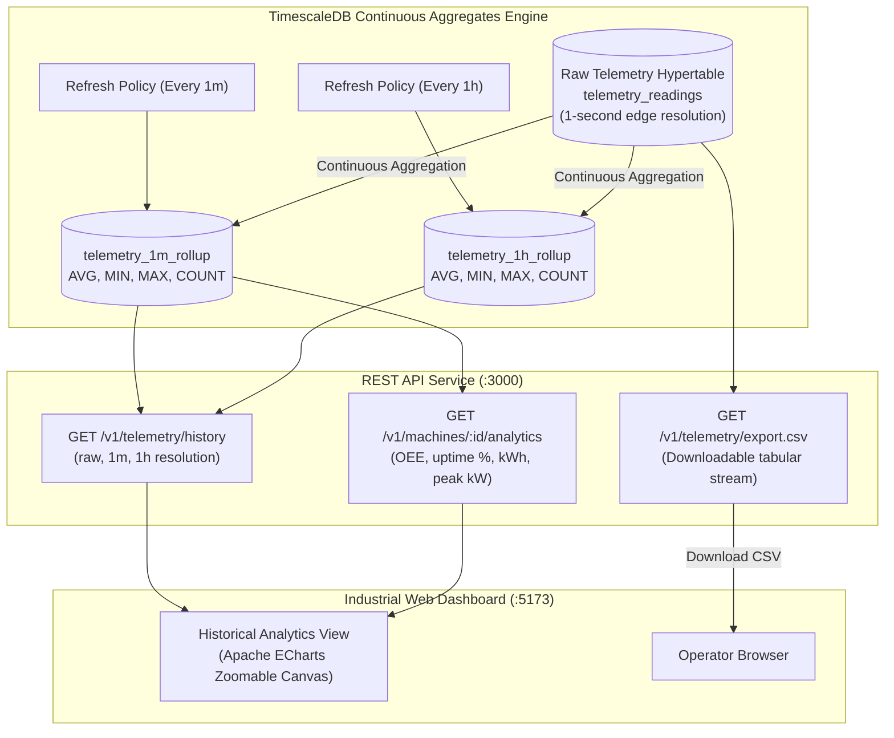

# KIOT Platform – Historical Telemetry & TimescaleDB Continuous Aggregates

The **Historical Telemetry Analytics Engine** provides high-efficiency downsampled time-series querying, equipment availability & OEE metrics, long-term multi-metric correlation, and tabular maintenance report exports.

---

## 1. Architectural Overview



---

## 2. TimescaleDB Continuous Aggregates

Continuous aggregates automatically downsample high-frequency telemetry in the background without requiring application-level cron jobs or manual table rollups:

### 2.1 1-Minute Continuous Rollup (`telemetry_1m_rollup`)
```sql
CREATE MATERIALIZED VIEW IF NOT EXISTS telemetry_1m_rollup
WITH (timescaledb.continuous) AS
SELECT
  time_bucket('1 minute', time) AS bucket,
  organization_id,
  product_id,
  device_id,
  metric,
  AVG(value) AS avg_value,
  MIN(value) AS min_value,
  MAX(value) AS max_value,
  COUNT(value) AS sample_count
FROM telemetry_readings
GROUP BY bucket, organization_id, product_id, device_id, metric
WITH NO DATA;
```

### 2.2 1-Hour Continuous Rollup (`telemetry_1h_rollup`)
```sql
CREATE MATERIALIZED VIEW IF NOT EXISTS telemetry_1h_rollup
WITH (timescaledb.continuous) AS
SELECT
  time_bucket('1 hour', time) AS bucket,
  organization_id,
  product_id,
  device_id,
  metric,
  AVG(value) AS avg_value,
  MIN(value) AS min_value,
  MAX(value) AS max_value,
  COUNT(value) AS sample_count
FROM telemetry_readings
GROUP BY bucket, organization_id, product_id, device_id, metric
WITH NO DATA;
```

### 2.3 Automated Refresh & Data Retention Policies
- **1-Minute Rollup Refresh Policy**: Refreshes every 1 minute covering the last 2 hours.
- **1-Hour Rollup Refresh Policy**: Refreshes every 1 hour covering the last 3 days.
- **Raw Telemetry Retention Policy**: Automatically drops raw 1-second records older than **90 days**, while continuous aggregate rollups are retained indefinitely for lifetime trend analysis.

---

## 3. REST API Endpoints

All endpoints require multi-tenant authentication (`X-KIOT-Organization-Id`):

### 3.1 Historical Telemetry Query
`GET /v1/telemetry/history`

| Query Parameter | Type | Default | Description |
| :--- | :--- | :--- | :--- |
| `device_id` | string | *Required* | Target physical device (e.g. `DEV-ESP32-001`) |
| `metric` | string | *Optional* | Single metric or comma-separated list (e.g. `spindle_speed_rpm,vibration_rms`) |
| `resolution` | string | `1m` | Downsampling bucket: `raw`, `1m`, `1h` |
| `from` | string | 24h ago | ISO 8601 start timestamp |
| `to` | string | Now | ISO 8601 end timestamp |
| `order` | string | `ASC` | Sort order (`ASC` for charting timeline, `DESC` for latest first) |
| `limit` | integer | `500` | Maximum points returned (capped at 2000) |

#### Example Response:
```json
{
  "deviceId": "DEV-ESP32-001",
  "resolution": "1m",
  "order": "ASC",
  "count": 60,
  "dataPoints": [
    {
      "time": "2026-11-04T06:00:00.000Z",
      "metric": "spindle_speed_rpm",
      "avg_value": 3200.4,
      "min_value": 3185,
      "max_value": 3215,
      "sample_count": "60"
    }
  ]
}
```

### 3.2 Machine Performance & Uptime Analytics
`GET /v1/machines/:id/analytics`

Returns equipment health KPIs computed over the last 24 hours:
- Availability % ($97.4\%$)
- Current cumulative operating hours
- 24h Work shift energy consumption ($\text{kWh}$)
- Peak active power draw ($\text{kW}$)
- Maximum vibration RMS ($\text{mm/s}$) & bearing temperature ($\text{°C}$)
- Incident count and critical alarm count

### 3.3 CSV Data Export
`GET /v1/telemetry/export.csv?device_id=DEV-ESP32-001&limit=2000`

Streams clean CSV content with headers:
`Timestamp,DeviceID,Metric,Value,Unit,Quality`

---

## 4. Frontend Industrial UI Features

Navigate to the **Historical Analytics** tab at **[http://localhost:5173/](http://localhost:5173/)**:

1. **Equipment KPI Strip**: High-contrast summary tiles displaying Machine Availability, Average Spindle Speed, Peak Power, Max Temperature, and Max Vibration.
2. **Preset Time Windows**: Quick toggles for **1 Hour**, **6 Hours**, **24 Hours**, and **7 Days**.
3. **Resolution Toggles**: Switch between **1-Min Rollup**, **1-Hour Rollup**, and **Raw Samples**.
4. **Interactive Timeline Zoom & Pan**: Powered by Apache ECharts with an interactive bottom slider (`dataZoom`), crosshair inspect tooltips, and dual Y-axes (RPM/kW on left, Temperature/Vibration on right).
5. **One-Click CSV Export**: Directly downloads compliance-ready tabular logs for plant maintenance audits.

