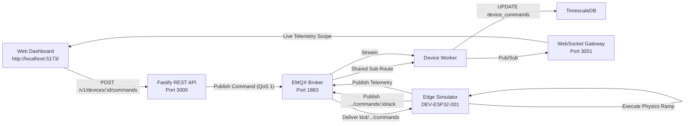

# KIOT Virtual Device Simulator – User & Operation Guide

> [!NOTE]
> This guide is also maintained at **[`docs/simulator-usage-guide.md`](file:///home/ketan/projects/Krisha/kiot-platform/docs/simulator-usage-guide.md)**.

The **KIOT Virtual Edge Device Simulator** (`services/device-simulator`) provides a realistic, software-driven industrial edge environment. It emulates physical microcontrollers (such as ESP32-S3) and smart sub-meters (such as Modbus RS-485 3-phase power meters) connected to industrial equipment without requiring physical hardware.

---

## 1. Quick Start

### 1.1 Prerequisites
Ensure the local infrastructure containers and backend services are active:
```bash
# 1. Start Docker backing containers (Postgres, TimescaleDB, Redis, EMQX)
pnpm docker:up

# 2. Start the core platform services (API, Worker, WebSocket Gateway, Industrial Frontend)
pnpm dev
```

### 1.2 Start the Simulator
In a separate terminal window, launch the interactive device simulator:
```bash
pnpm sim:device
```
*(Or with file watch mode: `pnpm dev:simulator`)*

Upon startup, the simulator connects to the local EMQX broker (`mqtt://localhost:1883`), registers itself as an active online edge device, subscribes to remote commands, and begins streaming multi-sensor telemetry every 1 second.

---

## 2. Emulated Edge Devices

The simulator provisions and runs industrial nodes belonging to the tenant (`00000000-0000-4000-a000-000000000001`):

| Device Identifier | Associated Machine | Description | Telemetry Streamed |
| :--- | :--- | :--- | :--- |
| **`DEV-ESP32-001`** | `MCH-001` (Apex 5-Axis VMC) | High-speed CNC Spindle Controller | Spindle Speed (RPM), Bearing Temp (°C), Radial Vibration (mm/s), Coolant Pump State |
| **`DEV-ESP32-003`** | Line 1 Sensor Node | Stamping Press #3 Vibration Sensor | Spindle Speed (RPM), Bearing Temp (°C), Radial Vibration (mm/s), Coolant Pump State |
| **`DEV-METER-001`** | `MCH-001` (Apex 5-Axis VMC) | 3-Phase Industrial Power Meter | Voltage (V), Current (A), Active Real Power (kW), Power Factor ($\cos\phi$), Frequency (Hz) |

### Simulating Any Custom or Additional Device

To simulate any custom device (or multiple devices concurrently), pass `CNC_DEVICE_ID` or a comma-separated list `CNC_DEVICE_IDS`:

```bash
# Simulate a specific onboarded device:
CNC_DEVICE_ID=DEV-ESP32-003 pnpm sim:device

# Simulate multiple devices concurrently:
CNC_DEVICE_IDS=DEV-ESP32-001,DEV-ESP32-003 pnpm sim:device
```

---

## 3. Interactive Keyboard Controls (Fault Injection)

When running in an interactive terminal, the simulator accepts single-keystroke inputs to simulate real-world factory operating scenarios and failure modes:

```text
==================================================================
🤖 KIOT VIRTUAL EDGE DEVICE SIMULATOR (IIoT Fleet)
==================================================================
  • Broker:       mqtt://localhost:1883
  • Organization: 00000000-0000-4000-a000-000000000001
  • Node 1 (CNC): DEV-ESP32-001 (CNC Milling Machine 01)
  • Node 2 (Pwr): DEV-METER-001 (3-Phase Smart Energy Meter)
  • Rate:         1 packet / sec (1000ms)
==================================================================
  Interactive Keyboard Controls:
    [1] 🟢 Mode: NORMAL (Nominal 3200 RPM, Coolant ON)
    [2] 🟡 Mode: HIGH_LOAD (4800 RPM, Elevated Thermal)
    [3] 🔴 Mode: VIBRATION FAULT (Radial Vibration > 5.0 mm/s)
    [4] 💥 Mode: OVERHEAT FAULT (Bearing Temp > 78.0 °C)
    [5] 🛑 Mode: EMERGENCY STOP (Halt all actuators immediately)
    [6] 🔄 Mode: RESET FAULTS (Restore nominal state)
    [q] 🚪 Quit Simulator
==================================================================
```

### Modes Breakdown:

| Key | Mode Name | Physics Behavior | Dashboard Reaction (`http://localhost:5173/`) |
| :---: | :--- | :--- | :--- |
| **`1`** | **Normal Operation** | Spindle target: 3200 RPM, Coolant: ON, Nominal load. | All gauges green. Spindle settles at ~3200 RPM, bearing temp stabilizes at ~48°C, vibration ~1.2 mm/s. |
| **`2`** | **High Load** | Spindle target: 4800 RPM, High cutting resistance. | Power meter climbs to ~18 kW. Bearing temp rises to ~62°C. Current draw increases proportionally. |
| **`3`** | **Vibration Fault** | Injects harmonic mechanical imbalance. | Radial vibration spikes past 5.5 mm/s, breaching ISO 10816 alarm thresholds. Status indicator turns **Amber/Red**. |
| **`4`** | **Overheat Fault** | Simulates coolant failure and friction wear. | Bearing temperature steadily climbs past 78°C, breaching thermal trip thresholds. |
| **`5`** | **Emergency Stop** | Hardware E-Stop trip cuts spindle motor immediately. | Spindle speed decelerates to 0 RPM. Active power drops to idle standby. Machine status updates to `STOPPED`. |
| **`6`** | **Reset Faults** | Clears all fault flags and restores normal cooling. | Spindle resumes smooth acceleration back to nominal 3200 RPM. Alarm status resets to normal. |
| **`q`** | **Quit** | Shuts down simulator. | Cleanly disconnects MQTT client and exits. |

---

## 4. Controlling Devices via Industrial Dashboard UI

Open the web frontend in your browser: **[http://localhost:5173/](http://localhost:5173/)**



### How to Dispatch Commands from the UI:
1. Navigate to the **Machines** view or the **Actuators & Control** view in the sidebar.
2. In the Equipment Table, find `CNC-01` (`Apex 5-Axis VMC`) and click **"Control"**.
3. **Modulate Spindle Speed:**
   - Drag the RPM slider to `4200 RPM`.
   - Click **"Apply RPM"**.
   - Notice the Command Audit log immediately record `SUCCEEDED` with edge execution notes.
   - Switch to the **Telemetry Scope** tab and watch the live chart smoothly ramp up to 4200 RPM in real time.
4. **Trigger Emergency Stop:**
   - Click the red **"EMERGENCY STOP"** button.
   - The simulator immediately halts the virtual motor, logs the emergency stop event, and marks the command as `SUCCEEDED`.

---

## 5. Controlling Devices via REST API (cURL)

You can also send actuator commands programmatically via the REST API. Ensure you include the tenant header `X-KIOT-Organization-Id: 00000000-0000-4000-a000-000000000001`.

### 5.1 Set Spindle RPM (`SET_SPEED`)
```bash
curl -X POST http://localhost:3000/v1/devices/DEV-ESP32-001/commands \
  -H "Content-Type: application/json" \
  -H "X-KIOT-Organization-Id: 00000000-0000-4000-a000-000000000001" \
  -d '{
    "commandType": "SET_SPEED",
    "payload": { "rpm": 4500 }
  }'
```

**Expected Response:**
```json
{
  "command": {
    "id": "cdd2a5f5-dea6-4453-ab61-6b6b39778fb9",
    "organization_id": "00000000-0000-4000-a000-000000000001",
    "device_id": "DEV-ESP32-001",
    "command_type": "SET_SPEED",
    "payload": { "rpm": 4500 },
    "status": "SUCCEEDED",
    "expires_at": "2026-11-04T05:18:55.266Z",
    "created_at": "2026-11-04T05:13:55.255Z"
  }
}
```

### 5.2 Control Coolant Relay (`SET_RELAY`)
```bash
curl -X POST http://localhost:3000/v1/devices/DEV-ESP32-001/commands \
  -H "Content-Type: application/json" \
  -H "X-KIOT-Organization-Id: 00000000-0000-4000-a000-000000000001" \
  -d '{
    "commandType": "SET_RELAY",
    "payload": { "relay": "coolant_pump", "state": "OFF" }
  }'
```

### 5.3 Emergency Stop (`EMERGENCY_STOP`)
```bash
curl -X POST http://localhost:3000/v1/devices/DEV-ESP32-001/commands \
  -H "Content-Type: application/json" \
  -H "X-KIOT-Organization-Id: 00000000-0000-4000-a000-000000000001" \
  -d '{
    "commandType": "EMERGENCY_STOP",
    "payload": {}
  }'
```

### 5.4 Query Command Audit History
```bash
curl -s -H "X-KIOT-Organization-Id: 00000000-0000-4000-a000-000000000001" \
  http://localhost:3000/v1/devices/DEV-ESP32-001/commands | jq .
```

---

## 6. Real-Time Telemetry Topics Reference

The simulator uses standard KIOT multi-tenant MQTT topic formats:

| Action | MQTT Topic Structure | Payload Example |
| :--- | :--- | :--- |
| **Telemetry Publish** | `kiot/{orgId}/devices/{deviceId}/telemetry` | `{"metric":"spindle_speed","value":3200,"unit":"RPM","deviceTimestamp":"..."}` |
| **Device State Publish** | `kiot/{orgId}/devices/{deviceId}/state` | `{"status":"online","firmware_version":"v2.4.1-esp32","spindle_state":"IDLE"}` |
| **Inbound Commands** | `kiot/{orgId}/devices/{deviceId}/commands` | `{"commandId":"uuid","commandType":"SET_SPEED","payload":{"rpm":4200}}` |
| **Command ACK** | `kiot/{orgId}/devices/{deviceId}/commands/{id}/ack` | `{"status":"SUCCEEDED","reason":"VFD Inverter set target to 4200 RPM"}` |

---

## 7. Troubleshooting & FAQs

### Q1: The simulator logs `MQTT Connection Error: connect ECONNREFUSED 127.0.0.1:1883`
- **Cause:** EMQX MQTT Broker container is not running.
- **Remedy:** Run `pnpm docker:up` to start the backing containers. Verify EMQX status with `docker ps | grep kiot-emqx-dev`.

### Q2: Telemetry appears in terminal but dashboard charts do not update
- **Remedy 1:** Verify the Ingestion Worker is running (`pnpm dev:worker`).
- **Remedy 2:** Verify the WebSocket Gateway is running (`pnpm dev:ws`).
- **Remedy 3:** Run `pnpm qa:check` to automatically diagnose the full pipeline.

### Q3: How do I change the streaming frequency or target device IDs?
Configuration settings can be adjusted in `.env` or via environment variables before running:
```bash
TELEMETRY_INTERVAL_MS=500 pnpm sim:device
```
*(Options: `TELEMETRY_INTERVAL_MS`, `CNC_DEVICE_ID`, `METER_DEVICE_ID`, `EMQX_HOST`, `EMQX_PORT`).*

