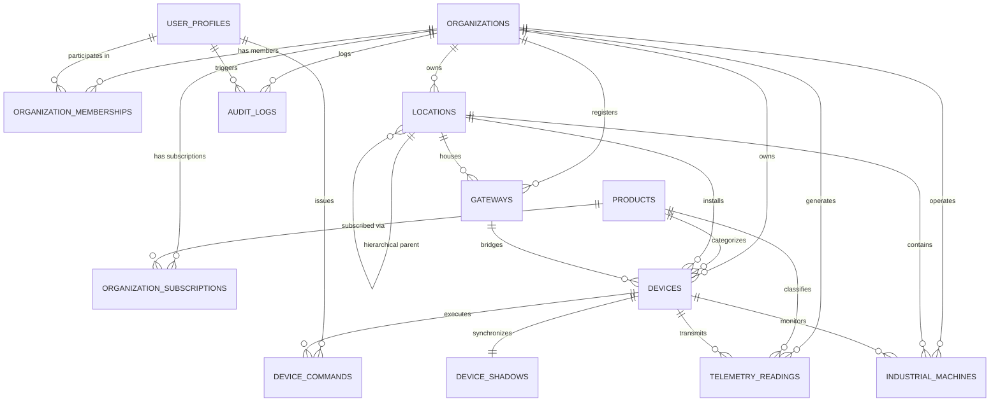

# KIOT Platform – Database Schema & Multi-Tenant Security Specification

**Document Version:** 1.0  
**Date:** 2026-11-04  
**Database Engines:** PostgreSQL 16 + TimescaleDB  
**Security Model:** PostgreSQL Row-Level Security (RLS) + Session Context  

---

## 1. Entity-Relationship Overview



---

## 2. Table Specifications & Relationships

### 2.1 Multi-Tenant Core

| Table Name | Primary Key | Key Foreign Keys | Purpose |
|---|---|---|---|
| `organizations` | `id` (UUID) | - | Root tenant entity; isolated by RLS. |
| `user_profiles` | `id` (UUID) | Matches `auth.users(id)` | Identity profiles for operators, admins, and viewers. |
| `organization_memberships` | `id` (UUID) | `organization_id`, `user_id` | M:N association with RBAC role (`owner`, `admin`, `manager`, `operator`, `viewer`). |
| `products` | `id` (`product_type`) | - | Platform catalog: `industrial`, `cold`, `home`, `energy`. |
| `organization_subscriptions` | `id` (UUID) | `organization_id`, `product_id` | Tenant product activation, device limits, and user limits. |

### 2.2 Asset & Topology Hierarchy

| Table Name | Primary Key | Key Foreign Keys | Purpose |
|---|---|---|---|
| `locations` | `id` (UUID) | `organization_id`, `parent_id` | Hierarchical site layout (`site` $\rightarrow$ `building` $\rightarrow$ `floor` $\rightarrow$ `line`). |
| `gateways` | `id` (TEXT/Serial) | `organization_id`, `location_id` | Linux edge gateways (Moxa, Advantech) bridging field protocols. |
| `devices` | `id` (TEXT/Serial) | `organization_id`, `product_id`, `gateway_id`, `location_id` | Physical edge devices (ESP32 sensor hubs, energy meters). |
| `device_shadows` | `device_id` (TEXT) | `organization_id` | Digital twin storing `desired`, `reported`, and `delta` JSON state. |
| `device_commands` | `id` (UUID) | `organization_id`, `device_id`, `issued_by` | Command dispatch lifecycle (`PENDING` $\rightarrow$ `SENT` $\rightarrow$ `ACK` $\rightarrow$ `SUCCEEDED`). |
| `industrial_machines` | `id` (UUID) | `organization_id`, `location_id`, `primary_device_id` | Physical manufacturing machinery, operating hours, and run/stop status. |

---

## 3. High-Frequency Time-Series (TimescaleDB)

### 3.1 Raw Telemetry Table (`telemetry_readings`)
The raw telemetry table is transformed into a **TimescaleDB hypertable** partitioned across 7-day time chunks.
- **Primary Key:** `(time, organization_id, device_id, metric)`
- **Columns:**
  - `time TIMESTAMPTZ NOT NULL`: Edge measurement timestamp.
  - `organization_id UUID NOT NULL`: Tenant ID for multi-tenant partitioning.
  - `product_id product_type NOT NULL`: `industrial`, `cold`, `home`, or `energy`.
  - `device_id VARCHAR(100) NOT NULL`: Hardware device identifier.
  - `gateway_id VARCHAR(100)`: Optional gateway routing identity.
  - `metric VARCHAR(100) NOT NULL`: e.g., `temperature`, `active_power`, `spindle_rpm`.
  - `value DOUBLE PRECISION NOT NULL`: Quantitative sensor reading.
  - `unit VARCHAR(50) NOT NULL`: `°C`, `kW`, `RPM`, `V`, `A`.
  - `quality VARCHAR(20) NOT NULL DEFAULT 'good'`: Measurement reliability indicator.
  - `sequence_number BIGINT`: Monotonically increasing edge sequence counter.

### 3.2 Continuous Aggregate Rollups
To support instant dashboard rendering over multi-day or multi-week spans, continuous aggregates compute rollups automatically:
1. **`telemetry_1m_rollup`:** 1-minute time buckets aggregating `avg_value`, `min_value`, `max_value`, and `sample_count`. Automatically refreshed every 1 minute.
2. **`telemetry_1h_rollup`:** 1-hour time buckets aggregating hourly averages, extremes, and counts. Automatically refreshed every 1 hour.

### 3.3 Data Retention Policy
- Raw telemetry data is automatically dropped after **90 days** via TimescaleDB's native retention policy:
  ```sql
  SELECT add_retention_policy('telemetry_readings', INTERVAL '90 days');
  ```
- Rollup materialized views (`telemetry_1m_rollup` and `telemetry_1h_rollup`) are preserved indefinitely for compliance and trend analytics.

---

## 4. Multi-Tenant Row-Level Security (RLS) Model

Security is enforced at the database kernel level through PostgreSQL Row-Level Security (RLS).

### 4.1 Session Context Variables
When the KIOT REST API handles an authenticated request, it verifies the Supabase Auth JWT and active organization header, then executes within a database transaction:
```sql
SET LOCAL app.current_user_id = '<user_uuid>';
SET LOCAL app.current_org_id = '<organization_uuid>';
```

### 4.2 Helper Security Functions (`app` Schema)
- `app.current_user_id()`: Returns active user UUID (from session setting or `auth.uid()`).
- `app.current_org_id()`: Returns active organization UUID.
- `app.is_org_member(target_org_id UUID)`: Verifies active membership in the organization.
- `app.get_org_role(target_org_id UUID)`: Returns user's RBAC role (`owner`, `admin`, `manager`, `operator`, `viewer`).

### 4.3 Policy Matrix

| Table | Read Policy (`SELECT`) | Write Policy (`INSERT`/`UPDATE`) | Delete Policy (`DELETE`) |
|---|---|---|---|
| `organizations` | Active member of org | Role `owner` or `admin` | Platform Super Admin only |
| `organization_memberships` | Active member of org | Role `owner` or `admin` | Role `owner` or `admin` |
| `locations` | Active member of org | Role `owner`, `admin`, `manager` | Role `owner` or `admin` |
| `gateways` | Active member of org | Role `owner`, `admin`, `manager` | Role `owner` or `admin` |
| `devices` | Active member of org | Role `owner`, `admin`, `manager` | Role `owner` or `admin` |
| `device_shadows` | Active member of org | Active member of org | Role `owner` or `admin` |
| `device_commands` | Active member of org | Role `owner`, `admin`, `manager`, `operator` | Prohibited (immutable audit log) |
| `industrial_machines` | Active member of org | Role `owner`, `admin`, `manager` | Role `owner` or `admin` |
| `telemetry_readings` | Active member of org | Ingestion worker / active member | Prohibited (handled by retention policy) |
| `audit_logs` | Role `owner` or `admin` | Automated trigger only | Prohibited (immutable audit trail) |

---

## 5. Migration Execution & Seed Tooling

The schema migrations and test seed data are automated via shell scripts and `pnpm`:

```bash
# Apply pending SQL migrations
pnpm db:migrate

# Seed development data (test org, devices, machines, historical telemetry)
pnpm db:seed

# Complete database reset and re-seed
pnpm db:reset
```

